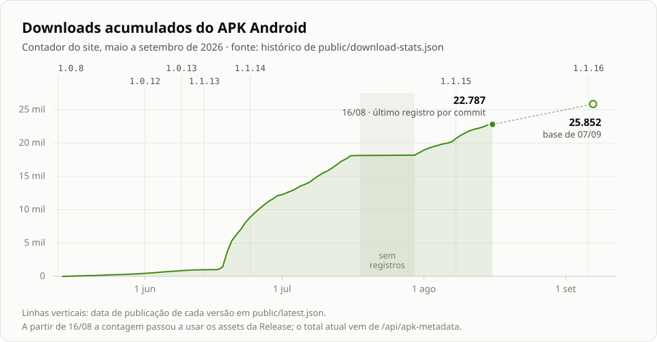
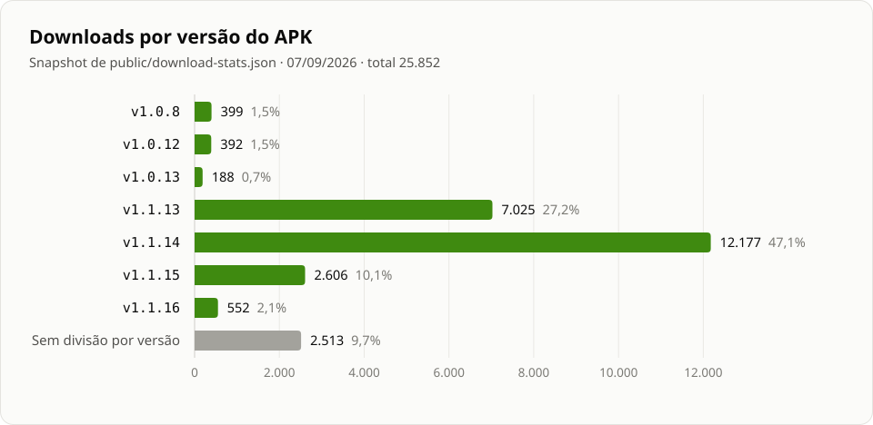
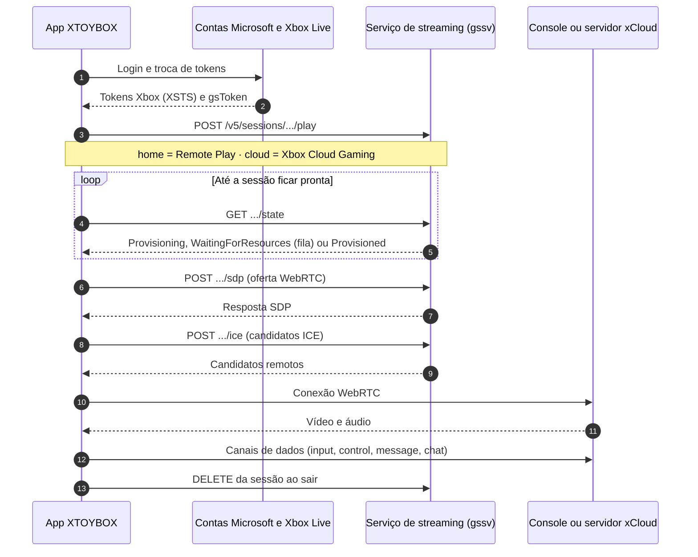
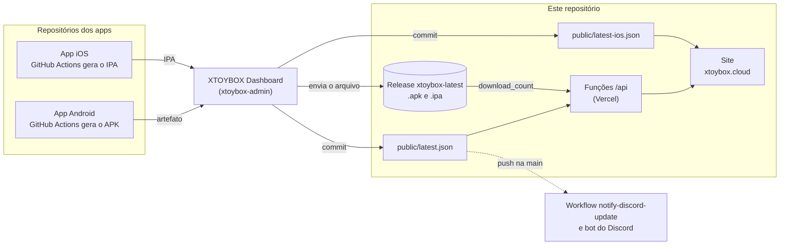

<p align="center">
  
</p>

<p align="center">
  <a href="https://xtoybox.cloud"><strong>Site</strong></a> ·
  <a href="https://xtoybox.cloud/downloads"><strong>Downloads</strong></a> ·
  <a href="https://github.com/jmita2288-debug/xtoybox-apk-download/releases"><strong>Releases</strong></a> ·
  <a href="https://xtoybox.cloud/seguranca-download"><strong>Verificar APK</strong></a> ·
  <a href="https://xtoybox.cloud/xtoytouch"><strong>XtoyTouch</strong></a> ·
  <a href="https://discord.gg/abh27Dwktt"><strong>Discord</strong></a>
</p>

<p align="center">
  <a href="https://xtoybox.cloud/downloads"></a>
  <a href="https://xtoybox.cloud/downloads"></a>
  <a href="#xtoybox-para-ios"></a>
  <a href="#créditos-e-licenças"></a>
  <a href="https://github.com/jmita2288-debug/xtoybox-apk-download/commits/main"></a>
</p>

Este repositório contém o site oficial do XTOYBOX ([xtoybox.cloud](https://xtoybox.cloud)) e a infraestrutura de distribuição dos apps: a Release `xtoybox-latest` com os arquivos APK e IPA, os manifestos de versão que os apps consultam e as funções serverless que fazem o download e calculam o contador público.

O **XTOYBOX** é um cliente independente para jogar pelo **Xbox Cloud Gaming** e pelo **Remote Play** do próprio console. O app Android deriva do projeto open source [XStreaming](https://github.com/Geocld/XStreaming); o app iOS é um cliente separado, feito para iPhone, que reaproveita a parte do núcleo que não depende de plataforma. O código dos apps fica em repositórios separados. Aqui ficam o site, a distribuição e esta documentação.

O XTOYBOX não opera servidores de cloud gaming. O vídeo, o áudio e os comandos trafegam entre o app e o console do usuário (Remote Play) ou os servidores da Microsoft (nuvem).

## Sumário

- [Estado atual](#estado-atual)
- [Downloads e estatísticas](#downloads-e-estatísticas)
- [Plataformas e compatibilidade](#plataformas-e-compatibilidade)
- [Recursos](#recursos)
- [Como o streaming funciona](#como-o-streaming-funciona)
- [XTOYBOX para iOS](#xtoybox-para-ios)
- [XtoyTouch](#xtoytouch)
- [Arquitetura do site](#arquitetura-do-site)
- [Desenvolvimento](#desenvolvimento)
- [Segurança do download](#segurança-do-download)
- [Histórico de versões](#histórico-de-versões)
- [Créditos e licenças](#créditos-e-licenças)
- [Suporte](#suporte)
- [Aviso legal](#aviso-legal)

## Estado atual

| Componente | Versão | Situação | Distribuição |
| --- | --- | --- | --- |
| App Android (celular, tablet, TV Box) | 1.1.17 (117) · 19/11/2026 | Versão pública, em desenvolvimento ativo | APK pelo site (`/api/download`) |
| App iOS (iPhone) | 1.1.3 (113) · 20/11/2026 | Beta pública, iniciada na 1.0.0 (18/11/2026) | IPA não assinado, instalação lateral |
| XtoyTouch (navegador) | 4.1.2 | Disponível | Userscript em [`/xtoytouch`](https://xtoybox.cloud/xtoytouch) |
| Site | branch `main` | Em produção na Vercel | [xtoybox.cloud](https://xtoybox.cloud) |

Versões conferidas em 20/11/2026. Os badges no topo leem `public/latest.json` e `public/latest-ios.json` e se atualizam sozinhos.

### Ainda não disponível ou em andamento

- **Remote Play no iOS.** Está no plano de port do app iOS (etapa 5). A 1.1.3 transmite apenas jogos da nuvem.
- **Teclado e mouse no Android.** Disponível desde a 1.1.16, ainda marcado como em testes. A compatibilidade depende do aparelho, do adaptador e do suporte do próprio jogo.
- **Google Play.** Não há versão na loja. O app Android ainda usa `targetSdk 34`, e a migração para a API exigida pela Play Store está documentada como pendente no repositório do app.
- **App Store e TestFlight.** O iOS é distribuído só como IPA não assinado.

## Downloads e estatísticas

<p>
  <a href="https://xtoybox.cloud/downloads"></a>
</p>

O número acima é calculado em produção a cada consulta e é o mesmo exibido no site. A fonte é [`/api/apk-metadata`](https://xtoybox.cloud/api/apk-metadata):

```text
total = 25.852 (base histórica)
      + download_count de cada asset XTOYBOX-v<versão>.apk (1.1.16 em diante) na Release xtoybox-latest
```

Arquivos `.ipa` não entram no contador. Publicar uma versão nova não zera o total, porque os APKs anteriores continuam somando. Se um APK antigo for removido da Release, a contagem final dele deve ir para `ARCHIVED_APK_DOWNLOADS` em `api/_android-release.js` (e no espelho `src/lib/apkMetadata.ts`).

### Histórico do contador (maio a setembro de 2026)

Entre 14/05 e 16/08/2026, cada download gerava um commit em `public/download-stats.json`. O arquivo foi alterado em 22.789 commits, e o gráfico abaixo foi reconstruído a partir deles (último valor de cada dia). Depois de 16/08 a contagem passou para os assets da Release, e em 07/09/2026 o total foi consolidado em 25.852, que hoje é a base histórica.

<picture>
  <source media="(prefers-color-scheme: dark)" srcset="./docs/downloads-history-dark.svg" />
  
</picture>

- O maior salto diário foi em 19/06/2026 (+2.272), logo depois de a 1.1.13 chegar ao site.
- Não há registros entre 14 e 16/06 nem entre 18 e 29/07. Nesses intervalos o contador não gravou commits.
- Os dados diários estão em [`docs/data/downloads-history.csv`](./docs/data/downloads-history.csv).

### Downloads por versão

<picture>
  <source media="(prefers-color-scheme: dark)" srcset="./docs/downloads-by-version-dark.svg" />
  
</picture>

<details>
<summary>Tabela com os valores</summary>

| Versão | Downloads | Participação |
| --- | ---: | ---: |
| 1.0.8 | 399 | 1,5% |
| 1.0.12 | 392 | 1,5% |
| 1.0.13 | 188 | 0,7% |
| 1.1.13 | 7.025 | 27,2% |
| 1.1.14 | 12.177 | 47,1% |
| 1.1.15 | 2.606 | 10,1% |
| 1.1.16 | 552 | 2,1% |
| Sem divisão por versão | 2.513 | 9,7% |
| **Total consolidado** | **25.852** | **100%** |

Fonte: `public/download-stats.json` (snapshot de 07/09/2026). A linha "sem divisão por versão" é a diferença entre o total e a soma das versões. Corresponde ao período em que a contagem já usava os assets da Release e o arquivo não registrava a versão. Downloads posteriores a 07/09/2026 estão apenas no total ao vivo.

</details>

## Plataformas e compatibilidade

| Plataforma | Requisito mínimo | Pacote | Observações |
| --- | --- | --- | --- |
| Android (celular e tablet) | Android 8.0 (API 26) | APK `com.xstreaming` | `compileSdk`/`targetSdk` 34 |
| Android TV e TV Box | Android 8.0 (API 26) | Mesmo APK | Interface de TV quando o aparelho é identificado como TV ou pela opção nas configurações |
| iPhone | iOS 15.1 | IPA não assinado | Build com o SDK do iOS 26. A barra com efeito Liquid Glass só aparece no iOS 26 ou superior |
| Navegador (XtoyTouch) | Gerenciador de userscripts | `XtoyTouch.user.js` | Funciona em `xbox.com/play` |

Requisitos de conta, comuns a todas as plataformas:

- **Remote Play:** um console Xbox One ou Series X|S com o Remote Play ativado, na mesma conta.
- **Nuvem:** uma conta com acesso ao Xbox Cloud Gaming. A disponibilidade de cada jogo depende da conta, do plano e da região.

## Recursos

| Recurso | Android 1.1.17 | iOS 1.1.3 |
| --- | :---: | :---: |
| Xbox Cloud Gaming | ✓ | ✓ |
| Remote Play do próprio console | ✓ | Planejado |
| Login com conta Microsoft | ✓ (XAL, MSAL como alternativa) | ✓ |
| Biblioteca, "Meus jogos" e detalhes do jogo | ✓ | ✓ |
| Perfil e conquistas | ✓ | ✓ |
| Fila de espera do xCloud | ✓ | ✓ |
| Tempo de nuvem restante (conta e sessão) | ✓ | ✓ |
| Painel do streaming em abas (Jogo, Imagem, Sessão) | ✓ | ✓ |
| Fortnite na versão mobile, com o toque do próprio jogo | ✓ | ✓ |
| Controle virtual na tela | ✓ (com editor de layout) | ✓ |
| Controle físico | ✓ Bluetooth e USB | ✓ Bluetooth |
| Microfone | ✓ | ✓ |
| Teclado e mouse | Em testes | — |
| Interface para TV | ✓ | — |
| Aviso de nova versão | ✓ | ✓ |
| Armazenamento dos tokens | Android Keystore (AES/GCM) | Keychain |

## Como o streaming funciona

O XTOYBOX tem dois modos de jogo, e os dois usam a mesma base técnica:

- **Remote Play (xHome):** a imagem vem do console Xbox do usuário. O app lista os consoles da conta e abre uma sessão com o console escolhido.
- **Xbox Cloud Gaming (xCloud):** a imagem vem de um servidor da Microsoft. O app escolhe a região a partir das ofertas liberadas para a conta e, se não houver servidor livre, acompanha a fila de espera.

### Autenticação

1. O usuário entra com a conta Microsoft nas páginas de autorização da Microsoft. O app não guarda a senha nem a envia a servidores do projeto. No Android, o login principal usa o fluxo XAL, com o MSAL como alternativa.
2. Os tokens da Microsoft viram tokens do Xbox Live (usuário e XSTS). Com eles, o app consulta perfil, biblioteca, conquistas e consoles.
3. Para jogar, o app obtém o token do serviço de streaming (`gsToken`) da oferta correspondente: xHome para Remote Play ou xCloud para a nuvem.
4. Os tokens ficam no aparelho: Android Keystore (AES/GCM) no Android desde a 1.1.15, Keychain no iOS.

### Sessão



- **Vídeo e áudio** chegam por WebRTC (`react-native-webrtc` nos dois apps). O Android tem dois motores de exibição, um nativo e outro baseado em WebView.
- **Controles** são enviados pelo canal `input`, tanto do controle físico quanto do controle virtual.
- **Toque nativo:** em jogos que aceitam toque (como o Fortnite), o app informa a entrada de toque, envia os toques diretamente ao jogo e não anuncia um controle até que um controle seja usado. Assim o jogo abre a interface de celular e desenha os próprios botões.
- **Microfone** usa o canal de chat (Opus). No iOS, a entrada de áudio só é aberta quando o microfone é ligado no painel.
- **Fila:** enquanto a sessão está em `WaitingForResources`, o app consulta a estimativa de espera do Xbox e mostra o tempo na tela de carregamento.

A documentação detalhada do protocolo herdada do XStreaming (autenticação, Web API e stream) acompanha o repositório do app Android.

## XTOYBOX para iOS

O app iOS não é uma cópia do Android. É um projeto React Native separado, com telas próprias para iPhone e um núcleo que reaproveita apenas a lógica de protocolo e de conta que não depende de plataforma.

| Camada | Conteúdo |
| --- | --- |
| `src/core/` | Autenticação, tokens, API do Xbox, sessão de streaming, pacotes de controle e toque |
| `src/platform/ios/` | Implementações específicas: Keychain, GameController, áudio, motor de streaming |
| `src/app/` | Telas do iPhone: início, biblioteca, detalhes, perfil, ajustes, streaming |

O que foi portado do Android: modelos de token, fluxo de login, API de sessões do xCloud, API web (perfil, consoles) e os canais e pacotes do WebRTC. O que ficou de fora: módulos nativos do Android, rotas de TV e o layout das telas Android.

**Tecnologias:** React Native 0.86, React 19.2, `react-native-webrtc` 124.0.8, Keychain para dados sensíveis e o framework GameController da Apple para controles físicos.

### Particularidades da versão 1.1.3

- **Contas sem Game Pass:** quando o Xbox recusa a oferta `xgpuweb`, o app consulta as ofertas liberadas para a conta. Assim, contas no modo gratuito com anúncios ou com horas de Cloud Playtime também entram.
- **Erros de login legíveis:** códigos do Xbox como conta sem perfil ou país sem suporte aparecem com explicação e um botão para resolver no site da Xbox.
- **Fortnite:** seletor de versão Mobile ou Windows nos detalhes do jogo, salvo por jogo.
- **Microfone:** só pede permissão quando é ligado. Com ele desligado, o indicador laranja do iPhone não aparece e o som do jogo entra na gravação de tela.
- **Biblioteca:** a última lista da conta aparece ao abrir o app e é substituída pela lista ao vivo. Há também a categoria de jogos gratuitos.
- **Tempo de nuvem:** saldo da conta (horas do plano e horas compradas) e tempo da sessão, ambos informados pelo próprio Xbox.

### Build e instalação

1. O IPA é gerado por GitHub Actions em macOS com Xcode 26, sem assinatura (`CODE_SIGNING_ALLOWED=NO`).
2. A publicação é feita pelo XTOYBOX Dashboard, que envia `XTOYBOX-v<versão>.ipa` para a Release `xtoybox-latest` e grava `public/latest-ios.json`.
3. O botão iOS do site lê esse manifesto. Se ele não estiver disponível, procura o `.ipa` mais recente na Release. Se não encontrar nenhum, mostra "Em breve".
4. A instalação é lateral, com uma ferramenta como o SideStore. Com uma Apple ID gratuita, a assinatura feita pela ferramenta expira em 7 dias e o app precisa ser renovado.

**Aviso de atualização:** o app consulta `xtoybox.cloud/latest-ios.json` e a cópia no GitHub, no máximo a cada 6 horas e nunca durante uma partida. Os botões são Baixar, Ignorar esta versão e Depois.

## XtoyTouch

XtoyTouch é um userscript que adiciona controles virtuais ao Xbox Cloud Gaming no navegador (`xbox.com/play`). Ele traz HUDs por jogo, um editor para mover e redimensionar os controles na área de jogo e um painel de ajustes acessível durante a sessão. É escrito por Alexandreios e distribuído sob a licença MIT.

### Instalação

1. Instale um gerenciador de userscripts, como Tampermonkey, Violentmonkey ou Userscripts.
2. Abra [`xtoybox.cloud/xtoytouch/XtoyTouch.user.js`](https://xtoybox.cloud/xtoytouch/XtoyTouch.user.js) e confirme a instalação.
3. Acesse o Xbox Cloud Gaming pelo navegador.

**Atualização:** o cabeçalho do script aponta `@updateURL` para `XtoyTouch.meta.js` e `@downloadURL` para `XtoyTouch.user.js`, ambos em `xtoybox.cloud/xtoytouch/`. Gerenciadores compatíveis detectam versões novas sozinhos.

**Como é publicado:** a fonte fica em `scripts/xtoytouch-source/`, compactada (gzip + base64) e dividida em partes. No build, `scripts/build-xtoytouch.mjs` remonta o arquivo, fixa o `@namespace` oficial e gera `public/xtoytouch/XtoyTouch.user.js` e `XtoyTouch.meta.js`. A rota `/api/xtoytouch` é uma alternativa que lê a fonte do repositório `Alexandre0062/touchx` e injeta os mesmos campos de atualização.

## Arquitetura do site

### Publicação e distribuição



- Android e iOS são publicados pelo mesmo Dashboard. Cada plataforma tem o próprio manifesto e o próprio tipo de arquivo na Release.
- Este repositório não gera APK nem IPA. Os builds acontecem nos repositórios dos apps.
- O app Android verifica atualizações em `latest.json` (servido a partir de `public/`). O app iOS usa `latest-ios.json`.
- Quando `public/latest.json` muda na `main`, o workflow `notify-discord-update` se autentica por OIDC e avisa o bot do Discord. Mudanças no manifesto iOS não disparam esse workflow.

### Fluxo do download

1. Todos os botões Android do site apontam para `/api/download`.
2. Se `VITE_GAM_REWARDED_AD_UNIT_PATH` estiver configurada, o clique abre antes um anúncio recompensado opcional (Google Ad Manager). O usuário pode pular e baixar direto.
3. `/api/download` lê `public/latest.json`, valida plataforma, versão e extensão e responde com `302` para o asset na Release.
4. O GitHub registra o download no `download_count` do asset. Nenhum commit é criado.

Regras que mantêm as plataformas separadas (`api/_android-release.js` e `src/lib/apkMetadata.ts`):

- o fluxo Android só aceita `platform: "android"` ou manifesto sem `platform` (formato antigo);
- a versão precisa ser numérica (`1.1.17`). Sufixos como `1.1.17-test` são recusados;
- `apkUrl` precisa usar https e terminar em `.apk`. Se estiver ausente, o link `XTOYBOX-v<versão>.apk` é montado a partir da Release;
- arquivos `.ipa` nunca entram no tamanho do APK nem no contador.

### Tecnologias

| Camada | Tecnologia |
| --- | --- |
| Interface | React 19, TypeScript, CSS próprio (`xt-ui.css`, `xt-home.css`, `xt-pages.css`), ícones Lucide |
| Build | Vite 7 (`vite.config.vercel.ts`) |
| Roteamento | Por `pathname`, em `src/vercel-entry.tsx` |
| Funções | Vercel Functions em Node.js (`api/`) |
| Hospedagem | Vercel, com Speed Insights |
| Dados | GitHub Releases e API do GitHub. Não há banco de dados. As curtidas por jogo ficam em arquivos JSON na branch `data/game-likes` |
| Publicidade | Google AdSense no site e anúncio recompensado opcional antes do download. O app não usa esse código |
| Fonte | Archivo (Google Fonts) |

O `package.json` também lista Tailwind CSS, Radix UI, componentes shadcn/ui, TanStack Start/Router/Query, Embla Carousel, Zod e React Hook Form. Eles vêm do template inicial e da versão anterior da página inicial (`src/routes/index.tsx`), mas não fazem parte do bundle de produção.

### Páginas

| Rota | Arquivo | Conteúdo |
| --- | --- | --- |
| `/` | `src/routes/index-refined.tsx` | Apresentação, botões Android e iOS, contador de downloads |
| `/downloads` | `src/routes/downloads-page.tsx` | Versão atual, tamanho, notas da versão e versões anteriores |
| `/xtoytouch` | `src/routes/xtoytouch.tsx` | Apresentação e instalação do XtoyTouch |
| `/seguranca-download` | `src/routes/legal-pages.tsx` | Origem, tamanho e SHA-256 do APK atual |
| `/privacidade` | `src/routes/legal-pages.tsx` | Política de privacidade do app e do site |
| `/termos` | `src/routes/legal-pages.tsx` | Termos de uso |

### API

| Rota | Métodos | Descrição |
| --- | --- | --- |
| `/api/download` | GET, HEAD | Redireciona (`302`) para o APK de `public/latest.json`. Envia os cabeçalhos `X-XTOYBOX-Platform` e `X-XTOYBOX-Version`, sem cache |
| `/api/apk-metadata` | GET, HEAD | Versão, notas, data, tamanho, SHA-256 (campo `digest` do asset) e total de downloads |
| `/api/download-badge` | GET | JSON no formato *endpoint* do Shields.io, usado pelo badge deste README |
| `/api/game-likes` | GET, POST | Curtidas por jogo. GET `?gameId=` retorna a contagem. POST `{ gameId, userId, action }` com `action` igual a `status` ou `toggle`. O ID do usuário é guardado só como HMAC |
| `/api/xtoytouch` | GET | Userscript XtoyTouch gerado da fonte remota. `?mode=meta` retorna só o cabeçalho |

Arquivos com `_` no início, como `api/_android-release.js`, não viram rota.

### Variáveis de ambiente

| Variável | Onde | Função |
| --- | --- | --- |
| `GITHUB_STATS_TOKEN` | `api/apk-metadata.js` | Leitura autenticada da Release. Opcional: se faltar ou for recusado, a leitura é feita sem autenticação. Também aceita `GH_TOKEN` e `SITE_REPO_TOKEN` |
| `SITE_REPO_TOKEN` | `api/game-likes.js` | Leitura e escrita na branch `data/game-likes`. Sem ele, o endpoint responde `503`. Também aceita `GITHUB_STATS_TOKEN` e `GH_TOKEN` |
| `XTOYBOX_LIKES_SECRET` | `api/game-likes.js` | Chave do HMAC que anonimiza o ID do usuário. Se faltar, usa o token |
| `SITE_URL` | `api/download-badge.js` | Origem usada quando a requisição não informa o host |
| `VITE_GAM_REWARDED_AD_UNIT_PATH` | `src/components/DownloadAdGate.tsx` | Ativa o anúncio recompensado opcional. Vazia, o download é direto |

Nenhum desses tokens é usado para criar commits a cada download.

### Manifestos de versão

`public/latest.json` (Android), gravado pelo Dashboard. A raiz do repositório também tem um `latest.json` com os mesmos dados de versão, atualizado nas publicações.

| Campo | Exemplo | Regra |
| --- | --- | --- |
| `platform` | `"android"` | Ausente = Android (formato antigo) |
| `latestVersionName` | `"1.1.17"` | Somente números |
| `latestVersionCode` | `117` | |
| `apkUrl` | `.../releases/download/xtoybox-latest/XTOYBOX-v1.1.17.apk` | https e terminado em `.apk` |
| `releaseTitle`, `releaseNotes[]` | | Exibidos em `/downloads` |
| `publishedAt` | `"2026-11-19"` | |
| `releaseChannel`, `testRelease` | `"public"`, `false` | |

`public/latest-ios.json` (iOS) usa `platform: "ios"`, `latestVersionName`, `latestVersionCode`, `ipaUrl` (https em `github.com`), `releaseTitle`, `releaseNotes[]` e `publishedAt`. O fluxo Android nunca lê esse arquivo.

O link curto `/downloads/XTOYBOX-v<versão>.apk` redireciona para o asset de mesmo nome na Release `xtoybox-latest`, para qualquer versão que ainda esteja lá.

## Desenvolvimento

### Requisitos

- Node.js `^20.19.0` ou `>=22.12.0` (exigência do Vite 7)
- npm. O `.npmrc` define `legacy-peer-deps=true`

### Executar a versão de produção localmente

```bash
git clone https://github.com/jmita2288-debug/xtoybox-apk-download.git
cd xtoybox-apk-download
npm install

# opcional: gera public/xtoytouch/ (necessário para testar /xtoytouch)
node scripts/build-xtoytouch.mjs

# mesma entrada da produção (index.html -> src/vercel-entry.tsx)
npx vite --config vite.config.vercel.ts
```

O servidor do Vite não executa as funções de `api/`. Sem elas, o site usa os fallbacks de `src/lib/apkMetadata.ts`: lê `public/latest.json` e consulta a Release pela API pública do GitHub. Para rodar as funções também, use a CLI da Vercel (`vercel dev`).

> `npm run dev` e `npm run build` usam `vite.config.ts`, herdado do template TanStack Start (Lovable/Cloudflare). Esse modo renderiza `src/routes/__root.tsx` e `src/routes/index.tsx`, a versão anterior da página inicial. Para trabalhar no site publicado, use `vite.config.vercel.ts`.

### Comandos

```bash
npx vite build --config vite.config.vercel.ts   # build de produção em dist/
npm run lint                                    # ESLint
npm run format                                  # Prettier
```

### Deploy

O deploy é feito pela Vercel a cada push na `main`, conforme o `vercel.json`:

| Configuração | Valor |
| --- | --- |
| Instalação | `npm install` |
| Build | `node scripts/build-xtoytouch.mjs && npx vite build --config vite.config.vercel.ts` |
| Saída | `dist` |
| Build ignorado | `scripts/ignore-vercel-build.js` pula commits automáticos do contador antigo (`Increment download count`, `Update compact download badge`) |
| Rewrites | Todas as rotas vão para `index.html` (SPA) |
| Redirecionamentos | `/reportar-bugs` vai para `/`. `/downloads/XTOYBOX-v*.apk` vai para o asset na Release |
| Cabeçalhos | Cache de 60 s e `Content-Type` JavaScript para os arquivos do XtoyTouch |

### Estrutura

```text
.
├── .github/workflows/
│   └── notify-discord-update.yml   # avisa o bot do Discord quando public/latest.json muda
├── api/                            # funções serverless (Vercel)
│   ├── _android-release.js         # regras do Android: manifesto, validação, contador
│   ├── apk-metadata.js
│   ├── download.js
│   ├── download-badge.js
│   ├── game-likes.js
│   └── xtoytouch.js
├── docs/                           # imagens e dados deste README
│   └── data/downloads-history.csv
├── public/                         # servido na raiz do site
│   ├── latest.json                 # manifesto Android (Dashboard)
│   ├── latest-ios.json             # manifesto iOS (Dashboard)
│   ├── download-stats.json         # snapshot do contador antigo (07/09/2026)
│   ├── download-badge.json         # snapshot antigo do badge, não usado
│   └── robots.txt, sitemap.xml, site.webmanifest, ads.txt
├── scripts/
│   ├── build-xtoytouch.mjs         # monta public/xtoytouch/
│   ├── xtoytouch-source/           # userscript compactado, em partes
│   ├── ignore-vercel-build.js
│   └── build-static.mjs
├── src/
│   ├── vercel-entry.tsx            # entrada de produção
│   ├── routes/                     # páginas (index-refined, downloads-page, legal-pages, xtoytouch)
│   ├── components/xt/              # cabeçalho, rodapé, botões de loja, tema
│   ├── components/                 # contador de downloads e gate de anúncio
│   ├── lib/apkMetadata.ts          # versão, tamanho e contador no navegador
│   └── xt-ui.css, xt-home.css, xt-pages.css
├── index.html
├── vercel.json
├── vite.config.vercel.ts           # build de produção
└── vite.config.ts, wrangler.jsonc  # template TanStack Start, fora do build da Vercel
```

## Segurança do download

- O botão do site redireciona para o arquivo publicado na Release do GitHub. O site não altera nem reconstrói o APK.
- A página [Segurança do download](https://xtoybox.cloud/seguranca-download) mostra versão, tamanho e o SHA-256 do APK atual, lidos da Release.
- O APK mantém o pacote `com.xstreaming` e o mesmo certificado das versões 1.1.14 a 1.1.16, para que a atualização instale por cima. Esse certificado é a chave de depuração pública do modelo do React Native, então a assinatura não comprova a origem do arquivo. Baixe apenas pelo site ou pela Release oficial e confira o SHA-256:

```bash
sha256sum XTOYBOX-v1.1.17.apk                               # Linux
shasum -a 256 XTOYBOX-v1.1.17.apk                           # macOS
Get-FileHash .\XTOYBOX-v1.1.17.apk -Algorithm SHA256        # Windows (PowerShell)
```

Para navegar no site ou baixar o APK, não é preciso criar conta nem informar a conta Microsoft. Detalhes sobre os dados tratados pelo app e pelo site estão na [Política de Privacidade](https://xtoybox.cloud/privacidade).

## Histórico de versões

Datas de `publishedAt` em `public/latest.json` e `public/latest-ios.json`. As notas completas de cada versão estão em [`/downloads`](https://xtoybox.cloud/downloads) e nas [Releases](https://github.com/jmita2288-debug/xtoybox-apk-download/releases).

### Android

| Versão | Data | Destaques |
| --- | --- | --- |
| 1.1.17 | 19/11/2026 | Fortnite na versão mobile, painel do streaming em abas, "Meus jogos" na tela inicial, tempo de nuvem restante, login mais estável, mouse durante o streaming |
| 1.1.16 | 06/09/2026 | Nova interface, teclado e mouse (em testes), fila no início da sessão, biblioteca e pesquisa mais rápidas |
| 1.1.15 | 08/08/2026 | Melhorias no streaming e nos controles virtuais |
| 1.1.14 | 24/06/2026 | Correções de estabilidade e menos atraso na navegação |
| 1.1.13 | 14/06/2026 | Categoria Grátis corrigida, lançamentos separados de "Adicionados recentemente" |
| 1.0.12 e 1.0.13 | 01/06 e 09/06/2026 | Tela inicial da TV e modo TV Box revisados |
| 1.0.5 a 1.0.8 | 12 e 13/05/2026 | Primeiras versões publicadas pelo site |

### iOS

| Versão | Data | Destaques |
| --- | --- | --- |
| 1.1.3 | 20/11/2026 | Fortnite na versão mobile, login para contas sem Game Pass, biblioteca mais rápida, microfone sob demanda, visual renovado |
| 1.0.0 | 18/11/2026 | Primeira versão pública (beta) |

## Créditos e licenças

### XStreaming

O app Android do XTOYBOX é um trabalho derivado do [**XStreaming**](https://github.com/Geocld/XStreaming), criado por [Geocld](https://github.com/Geocld). O XStreaming é um cliente open source em React Native para Xbox Cloud Gaming e Remote Play.

Partes herdadas do XStreaming:

- autenticação (XAL/MSAL) e cadeia de tokens Microsoft e Xbox;
- API web do Xbox (perfil, consoles, conquistas, catálogo);
- sessões de xCloud e xHome, regiões, WebRTC/ICE e protocolo de dados;
- controles físicos, controles virtuais, HUD e configurações de streaming;
- a documentação técnica do protocolo (autenticação, Web API e stream).

Partes alteradas ou adicionadas pelo XTOYBOX: interface e navegação próprias, modo TV, biblioteca, perfil, conquistas, detalhes de jogos, "Meus jogos", tempo de nuvem, painel do streaming, toque nativo para o Fortnite, armazenamento seguro de tokens, remoção de telemetria herdada, correções de login e o fluxo de build e publicação.

Identificadores internos foram mantidos de propósito: o pacote Android `com.xstreaming` e o nome de registro `xstreaming`. Trocar o pacote impediria a atualização das versões já instaladas. Na 1.1.17 foram removidos os serviços de suporte do projeto original que o app ainda consultava (descoberta de TURN e lista de apoiadores). Continua em uso um JSON complementar do catálogo hospedado no repositório original.

O app iOS não deriva do XStreaming diretamente. Ele reaproveita, portada, a lógica de protocolo e de conta do app Android, e por isso também se apoia nesse trabalho.

**Licença.** O XTOYBOX foi criado em maio de 2026 a partir de versões do XStreaming publicadas sob a licença MIT, e o repositório do app Android mantém esse aviso de copyright. Em 08/10/2026 o XStreaming passou a ser distribuído sob a [AGPL-3.0](https://github.com/Geocld/XStreaming/blob/main/LICENSE). Código do XStreaming publicado a partir dessa data segue a AGPL-3.0, e qualquer trecho novo incorporado de lá precisa respeitar essa licença.

<details>
<summary>Aviso de licença MIT do XStreaming, mantido no app Android</summary>

```text
The MIT License (MIT)
Copyright (c) 2024 Geocld (lijiahao5372@gmail.com)

Permission is hereby granted, free of charge, to any person obtaining a copy of
this software and associated documentation files (the "Software"), to deal in
the Software without restriction, including without limitation the rights to
use, copy, modify, merge, publish, distribute, sublicense, and/or sell copies of
the Software, and to permit persons to whom the Software is furnished to do so,
subject to the following conditions:

The above copyright notice and this permission notice shall be included in all
copies or substantial portions of the Software.

THE SOFTWARE IS PROVIDED "AS IS", WITHOUT WARRANTY OF ANY KIND, EXPRESS OR
IMPLIED, INCLUDING BUT NOT LIMITED TO THE WARRANTIES OF MERCHANTABILITY, FITNESS
FOR A PARTICULAR PURPOSE AND NONINFRINGEMENT. IN NO EVENT SHALL THE AUTHORS OR
COPYRIGHT HOLDERS BE LIABLE FOR ANY CLAIM, DAMAGES OR OTHER LIABILITY, WHETHER
IN AN ACTION OF CONTRACT, TORT OR OTHERWISE, ARISING FROM, OUT OF OR IN
CONNECTION WITH THE SOFTWARE OR THE USE OR OTHER DEALINGS IN THE SOFTWARE.
```

</details>

### Greenlight e xbox-xcloud-player

O XStreaming cita o [Greenlight](https://github.com/unknownskl/greenlight), de [UnknownSKL](https://github.com/unknownskl) (Jim Kroon), como inspiração. O Greenlight é construído sobre a biblioteca [xbox-xcloud-player](https://github.com/unknownskl/xbox-xcloud-player), do mesmo autor. Os dois são referências da implementação do protocolo de streaming do Xbox e usam a licença MIT (Greenlight: Copyright (c) 2019 UnknownSKL). Não são dependências diretas do XTOYBOX.

### Outros projetos

| Projeto | Uso | Licença |
| --- | --- | --- |
| [XtoyTouch](https://xtoybox.cloud/xtoytouch), por Alexandreios | Userscript de controles virtuais distribuído pelo site | MIT |
| [Lovable](https://lovable.dev) | Estrutura inicial do site (template TanStack Start). Interface, conteúdo, APIs e fluxo de download foram reescritos depois | — |

### Dependências

#### Apps (Android e iOS)

| Projeto | Uso | Licença |
| --- | --- | --- |
| [React Native](https://github.com/facebook/react-native) | Base dos dois apps | MIT |
| [react-native-webrtc](https://github.com/react-native-webrtc/react-native-webrtc) | Vídeo, áudio e canais de dados do streaming | MIT |
| [react-native-mmkv](https://github.com/mrousavy/react-native-mmkv) | Configurações e cache no Android | MIT |
| [React Navigation](https://github.com/react-navigation/react-navigation) | Navegação no Android | MIT |
| [React Native Paper](https://github.com/callstack/react-native-paper) | Componentes de interface no Android | MIT |
| [UI Kitten](https://github.com/akveo/react-native-ui-kitten) | Componentes de interface no Android | MIT |
| [sdp-transform](https://github.com/clux/sdp-transform) | Leitura e escrita de SDP | MIT |

#### Site

| Projeto | Uso | Licença |
| --- | --- | --- |
| [React](https://github.com/facebook/react) | Interface | MIT |
| [Vite](https://github.com/vitejs/vite) | Build | MIT |
| [Lucide](https://github.com/lucide-icons/lucide) | Ícones | ISC |
| [Vercel Speed Insights](https://github.com/vercel/speed-insights) | Métricas de desempenho | MIT |
| [Archivo](https://fonts.google.com/specimen/Archivo) | Tipografia | SIL OFL 1.1 |
| [Tailwind CSS](https://github.com/tailwindlabs/tailwindcss), [Radix UI](https://github.com/radix-ui/primitives), [shadcn/ui](https://github.com/shadcn-ui/ui), [TanStack](https://github.com/TanStack/router), [Embla Carousel](https://github.com/davidjerleke/embla-carousel), [Zod](https://github.com/colinhacks/zod), [React Hook Form](https://github.com/react-hook-form/react-hook-form) | Template inicial e versão anterior da página inicial | MIT |

Cada projeto mantém a própria licença e os próprios avisos de copyright. A lista completa de dependências do site está no `package.json`.

### Licença deste repositório

Este repositório ainda não inclui um arquivo `LICENSE`. Até que um seja adicionado, o código do site não é oferecido sob uma licença open source. Os componentes de terceiros listados acima continuam sob as licenças originais.

## Suporte

- [Discord](https://discord.gg/abh27Dwktt): avisos de versões, dúvidas e relatos de problemas
- E-mail: [Alexadre069@proton.me](mailto:Alexadre069@proton.me)

Um bom relato informa o modelo do aparelho, a versão do Android ou do iOS, a versão do XTOYBOX, o modo usado (nuvem ou Remote Play) e os passos para reproduzir o problema. Nunca envie senha, código de verificação ou token da conta Microsoft.

## Aviso legal

O XTOYBOX é um projeto independente. Não tem vínculo, parceria, aprovação ou patrocínio da Microsoft, do Xbox, do Xbox Cloud Gaming ou do Game Pass. Todos os nomes, marcas e serviços citados pertencem aos respectivos proprietários.

---

<p align="center">
  <sub>XTOYBOX · projeto independente baseado em software open source · <a href="https://xtoybox.cloud">xtoybox.cloud</a></sub>
</p>
